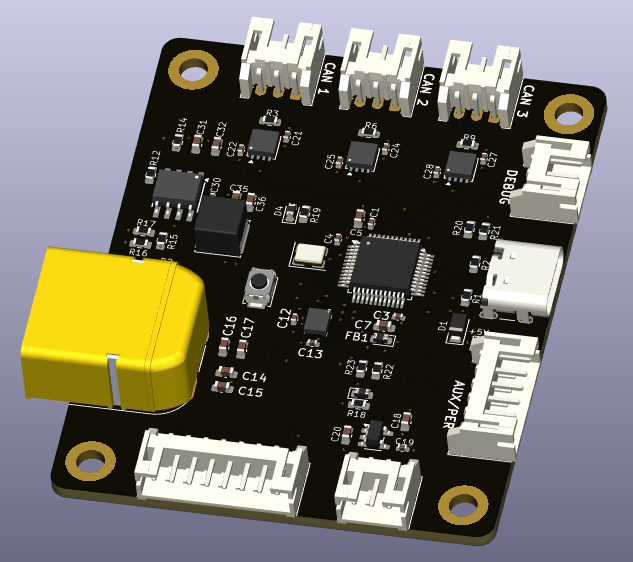
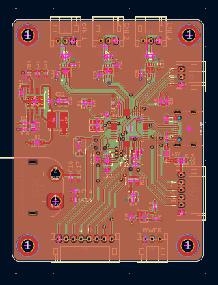
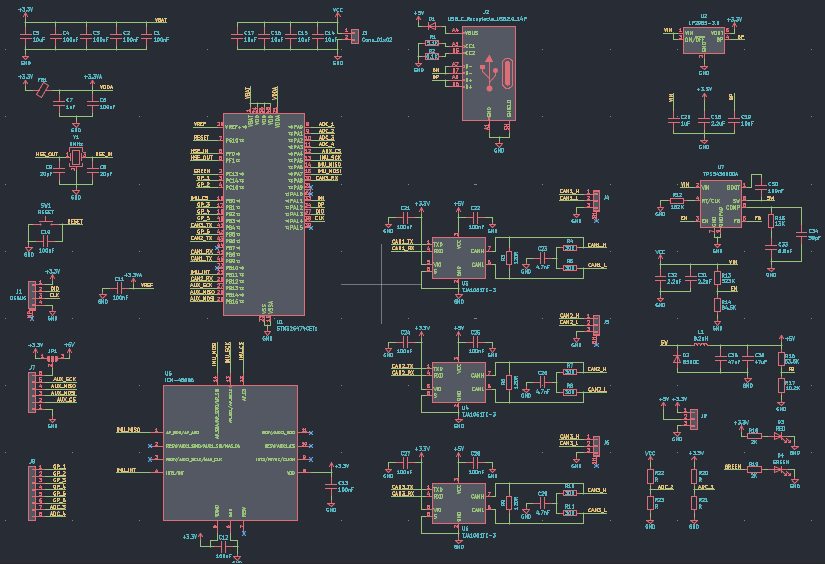

# Tripod (Controller)
A device that works as the brains of a tri-legged hopping robot!

## Overview
Tripod-controller is a 4 layer printed circuit board which is to be used as the computing and instructory brains of a major robot project I've been working on.

The board handles the robot's main control electronics, providing the necessary computing capabilities for its various subsystems both planned and unplanned.

## Design
 
  
SEE [SCHEMATICS](KiCAD/Controller.pdf)

## Build Instructions
1. Order the PCB using the provided [files](KiCAD/production).
2. Solder all SMD components according to the schematic and PCB layout.
3. Inspect all solder joints and check for shorts.
4. Connect the peripherals according to the schematic.
5. Flash the firmware and verify all interfaces.
6. Test the power rails before connecting the motors.

## BOM
| Category | Item | Quantity | Supplier | Unit Cost (USD) | Total Cost (USD) | Notes |
|---|---|---:|---|---:|---:|---|
| PCB manufacturing | JLCPCB order | 1 | JLCPCB | $134.68 | $134.68 | JLCPCB order subtotal |
| Shipping | FedEx shipping | 1 | FedEx | $27.19 | $27.19 | Included in the quoted JLCPCB total |
| Passive components | SMD resistors | As required | Daraz | $0.00 | $0.00 | Already owned |
| Passive components | SMD capacitors | As required | Daraz | $0.00 | $0.00 | Already owned |
| **TOTAL** |  |  |  |  | **$161.87** |  |

### SEE [BOM](BOM.csv)

## IMPORTANT
1. Use a 3-4s LiPo battery if you decide to use this board in your project. Discard the battery if it smells "funny".

2. Check for any damage on the pcb as it can be the reason for a catastrophic failure.

## License
MIT-License - SEE [LICENSE](LICENSE)

## Author
Shaurya Tamang  
Contact: [Email](shauryatamand.dev@gmail.com)